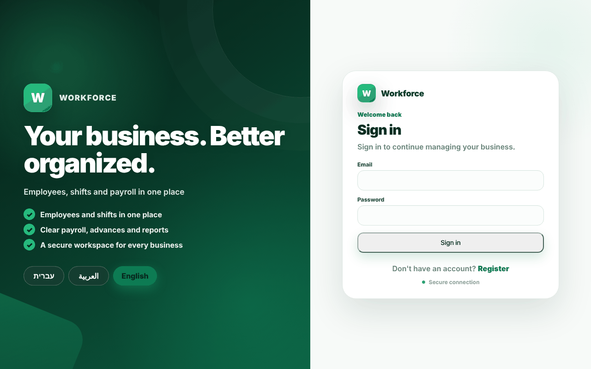
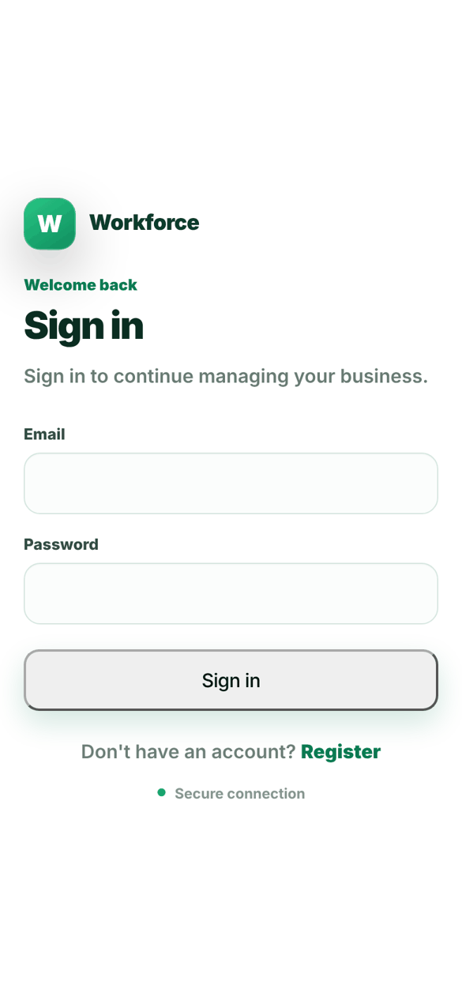
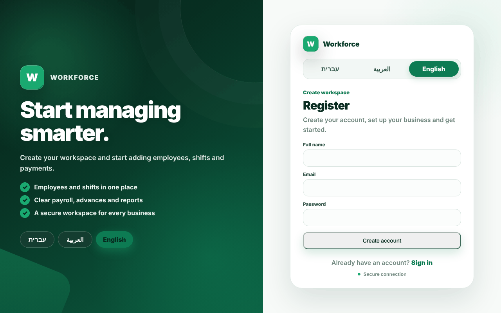
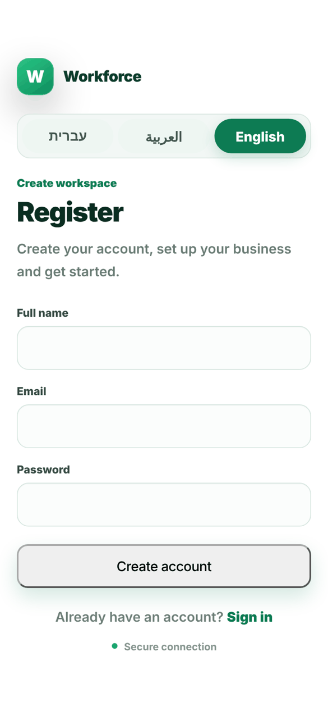

# Workforce SaaS

Multi-tenant SaaS for small businesses that manage hourly staff: employees, shifts, advances and payroll — in Hebrew, Arabic and English.

## Screenshots

| Desktop | Mobile |
|---|---|
| **Login**  |  |
| **Register**  |  |

## Features
- **Supabase Auth** – register, login, sessions, onboarding wizard that creates a business.
- **Multi-tenant** – every row scoped by `business_id` and protected with Row Level Security.
- **3 languages** – Hebrew / العربية / English with automatic RTL/LTR and per-language typography (Heebo, Noto Sans Arabic, Inter).
- **Employees** – search, add, edit, activate/deactivate, two hourly rates.
- **Shifts** – monthly view, client & location, hours, status, assign employees with vehicle and extras.
- **Advances** – dynamic advance givers, date, amount, reason.
- **Payroll** – gross, paid, net-to-pay, mark as paid.
- **Settings** – business name, language, currency, overtime threshold, rounding, clients, locations.
- Mobile-first responsive UI.

## Tech stack
HTML · CSS · Vanilla JavaScript · Supabase (Auth, Postgres, RLS) · Netlify

## Setup
1. Create a Supabase project and run the schema SQL, then `database-grants.sql`.
2. In `js/config.js` set `SUPABASE_URL` and the **publishable/anon key only** (never `service_role`).
3. Deploy the folder to Netlify or run a local static server.
